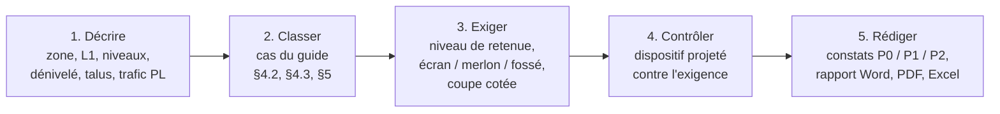
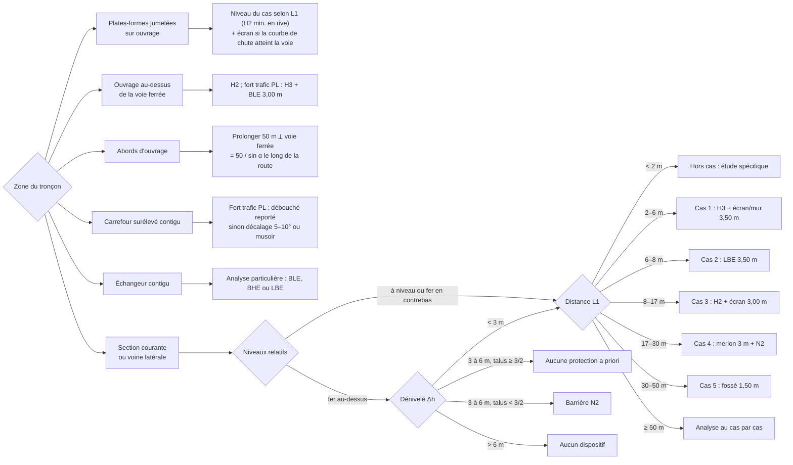

# GÉFRA

Application web d'aide à la définition et au contrôle des **dispositifs de protection anti-pénétration** à l'interface entre une route (ou autoroute) et une voie ferrée jumelées, d'après le guide technique Sétra *« Géfra – Jumelage des plates-formes ferroviaires et routières ou autoroutières »* (avril 2004, réf. 0401).

Site statique : HTML, CSS et JavaScript (modules ES), sans étape de compilation ni serveur applicatif. Les projets restent dans le navigateur de l'utilisateur.

## Fonctions

| Onglet | Rôle |
|---|---|
| **Comprendre** | L'essentiel en quatre écrans : la mesure de L1 selon chaque profil, le cas avec sa coupe type cotée (cliquer sur un cas), toutes les situations en plan, le passage du contrôle au constat. |
| **Assistant** | Détermine, pour une configuration, le cas Géfra, le niveau de retenue et l'élément anti-pénétration exigés. Il présente les solutions du guide avec une coupe type cotée à la valeur réelle de L1, puis contrôle le dispositif projeté. |
| **Linéaire** | Analyse tronçon par tronçon (PK, côté, zone, L1, dénivelé, talus, dispositif projeté). Saisie directe, collage depuis Excel, import CSV ou XLSX, modèle .xlsx fourni. |
| **Constats** | Constats générés à partir des écarts (localisation, constat, risque, recommandation, référence au guide), classés P0, P1 ou P2. L'auditeur peut modifier la priorité et les textes. |
| **Rapport** | Note de contrôle avec cartouche, synthèse, tableau du linéaire, constats, fiche de configuration et points de vérification. Export Word (.docx), PDF par l'impression du navigateur, tableaux Excel (.xlsx). |
| **Calculs** | Courbe de chute du chargement (§3.1), longueur de protection aux abords des ouvrages (§5.2), implantation du merlon (§4.2, 4e cas). |
| **Référentiel** | Synthèse des règles appliquées avec leurs schémas, catalogue des dispositifs, sigles. |

## Comment ça marche

L'onglet **Comprendre** présente ce fonctionnement en quatre écrans : la mesure de L1 selon chaque profil, le cas et sa coupe type cotée, toutes les situations en plan, le passage du contrôle au constat. Le schéma des niveaux différents est dans l'onglet **Référentiel**. Tous sont redessinés et renvoient à la page du guide concernée.



La donnée clé est **L1** : la distance entre la limite de la largeur roulable (bord extérieur de la BAU ou de la BDD) et la limite des aménagements ferroviaires (entrée en terre : assainissement, crête de déblai, pied de remblai ou nu d'un mur anti-bruit).



## Règles appliquées

- **Section courante, même niveau ou voie ferrée en contrebas (§4.2, §4.3)** :
  - 2 m ≤ L1 < 6 m : niveau H3 et écran ou mur de 3,50 m.
  - 6 m ≤ L1 < 8 m : LBE de 3,50 m.
  - 8 m ≤ L1 < 17 m : niveau H2 et écran de 3,00 m.
  - 17 m ≤ L1 < 30 m : merlon de 3 m minimum et glissière N2.
  - 30 m ≤ L1 < 50 m : fossé de 1,50 m.
  - L1 ≥ 50 m : analyse au cas par cas.
  - L1 < 2 m : hors des cas types.
- **Voie ferrée au-dessus (§4.3)** :
  - dénivelé < 3 m : règles du §4.2 ;
  - dénivelé de 3 à 6 m : aucune protection si le talus est au moins aussi raide que 3/2, barrière N2 sinon ;
  - dénivelé > 6 m : aucune protection.
- **Zones particulières (§5)** :
  - ouvrage au-dessus de la voie ferrée : H2, ou H3 avec un ensemble BLE de 3 m si le trafic PL est fort ;
  - abords : 50 m / sin α le long de la route ;
  - plates-formes jumelées sur ouvrage : continuité de la protection et courbe de chute ;
  - carrefours et échangeurs contigus.

Interprétations propres à l'application, signalées à l'écran :

- 1er cas : la solution « indiquée » dépend du tiers de l'intervalle 2–6 m où se situe L1 (« proche de 2 m », intermédiaire, « proche de 6 m »).
- Plates-formes jumelées sur ouvrage, quand la section courante relèverait d'un merlon ou d'un fossé : niveau H2 minimum en rive.
- Échangeur : niveau H2 minimum (ou celui de la section courante s'il est plus élevé) et écran de 3 m.
- Priorités : P0 pour un niveau de retenue insuffisant ou l'absence d'écran, de mur ou de merlon exigé, ainsi que pour un accès de service en 1er cas. P1 pour une hauteur insuffisante, une géométrie non conforme ou une longueur aux abords trop courte. P2 pour un point à justifier.

GÉFRA est un outil d'aide à la décision : le guide Sétra reste le document de référence, et les normes et homologations qu'il cite (2004) doivent être vérifiées dans leur version en vigueur.

## Lancer en local

Les modules ES ne se chargent pas depuis `file://`. Servez le dossier :

```bash
python3 -m http.server 8080
```

puis ouvrez <http://localhost:8080>.

## Tests

Les règles du moteur (`js/engine.js`) sont couvertes par des tests Node (version 18 ou plus) :

```bash
npm test
```

## Déploiement : GitHub puis Cloudflare Pages

1. Créer le dépôt `gefra` sur GitHub, puis depuis ce dossier :

   ```bash
   git init
   git add .
   git commit -m "GÉFRA : première version"
   git branch -M main
   git remote add origin https://github.com/<votre-compte>/gefra.git
   git push -u origin main
   ```

2. Dans Cloudflare : **Workers & Pages → Create → Pages → Connect to Git**, choisir le dépôt `gefra`, puis :
   - Framework preset : **None**
   - Build command : *(vide)*
   - Build output directory : **/**

   Chaque `git push` sur `main` redéploie le site. Le fichier `_headers` applique la politique de sécurité (CSP) et les en-têtes de cache.

## Structure

```
index.html          structure des vues
css/style.css       thèmes clair et sombre, impression A4 paysage
js/engine.js        moteur de règles Géfra (pur, testé)
js/schemas.js       coupes types et graphiques SVG
js/modele.js        projet, constats, synthèse
js/exports.js       import CSV/XLSX, export Word/Excel/JSON
js/app.js           interface
js/store.js         stockage local (localStorage)
js/exemple.js       projet d'exemple (données fictives)
js/comprendre.js    vue « Comprendre » et ses schémas explicatifs
test/               tests du moteur
_headers            en-têtes HTTP pour Cloudflare Pages
```

Bibliothèques chargées à la demande depuis un CDN, avec contrôle d'intégrité (SRI) : SheetJS 0.18.5 pour Excel et docx 8.5.0 pour Word.

## Données et confidentialité

Les projets sont enregistrés dans le `localStorage` du navigateur ; rien n'est envoyé à un serveur. Pour sauvegarder un projet, le transmettre ou changer de poste, utilisez **Exporter le projet (.json)** et **Importer un projet** dans le menu « ⋯ ».

Ne versionnez pas le PDF du guide Sétra : sa reproduction, même partielle, est soumise à l'autorisation du Sétra (désormais Cerema).
